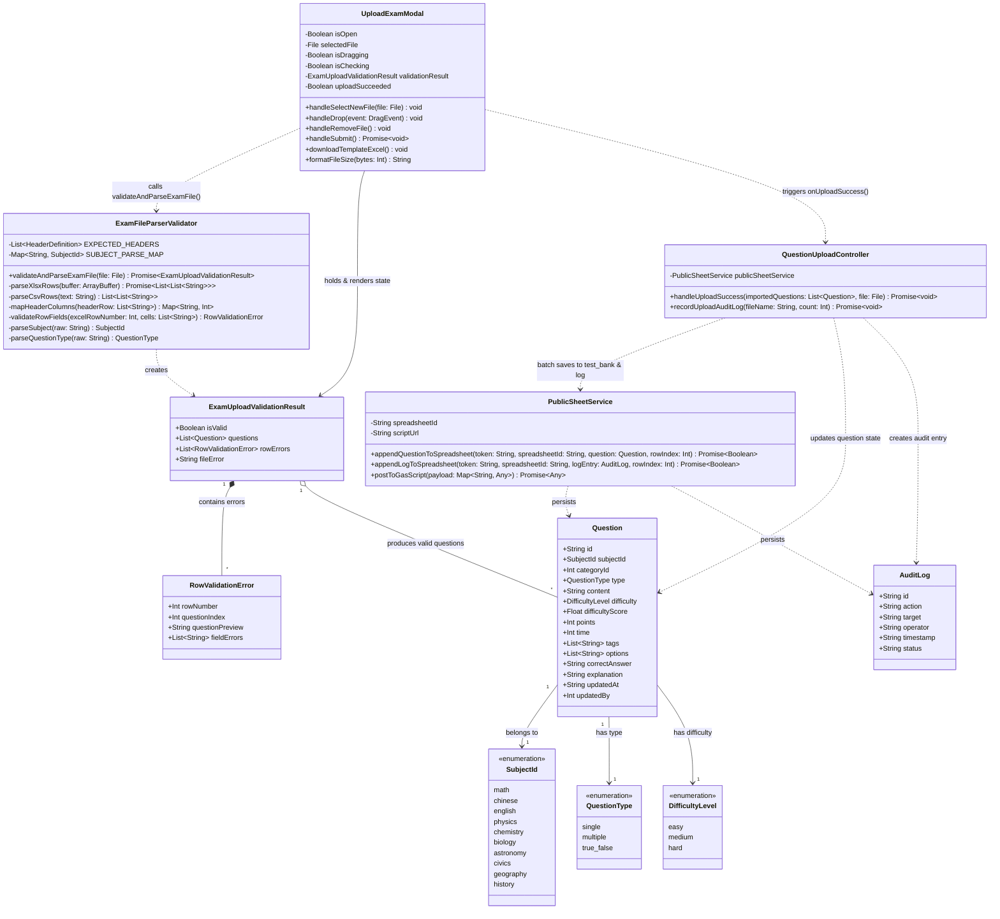

# 「上傳整份試卷」User Story 需求與 UML 類別圖設計

## 一、User Stories（使用者故事與驗收條件）

1. **US-1 下載標準範例 Excel 檔**
   - **身為** 題庫管理員 / 教師，**我希望** 在「上傳整份試卷」視窗中能一鍵下載標準範例 Excel 檔（`題庫試卷上傳範例.xlsx`），**以便** 依照系統規定的 13 個欄位格式快速填寫整份試卷題目。
2. **US-2 選取或拖曳本地試卷檔案**
   - **身為** 題庫管理員 / 教師，**我希望** 能透過點擊瀏覽或拖曳方式選取本地 `.xlsx` / `.csv` 試卷檔案，並在畫面上檢視檔名、檔案大小或移除重選，**以便** 確認即將上傳的試卷檔案無誤。
3. **US-3 試卷檔案結構與欄位完整性審查機制**
   - **身為** 題庫管理員 / 教師，**我希望** 點擊「上傳試卷」時系統自動審查標題列與每一題的所有必填欄位（所屬學科、試題類型、難度 1~5、配分、題目時長、知識點標籤、題目內文、選項 A~D、正確解答、題目詳解），**以便** 在欄位缺漏或數值越界時跳出「上傳失敗」並精準提醒是第幾題（Excel 第幾列）的哪個欄位有問題。
4. **US-4 審查通過匯入題庫與雲端資料庫同步**
   - **身為** 題庫管理員 / 教師，**我希望** 當試卷所有欄位審查通過後顯示「上傳成功」，自動將整批題目匯入題庫（`test_bank`）並記錄操作審計日誌（`log`），**以便** 立即在題庫管理列表中檢視與使用該批試題。

---

## 二、UML 類別圖 (Mermaid Class Diagram)

